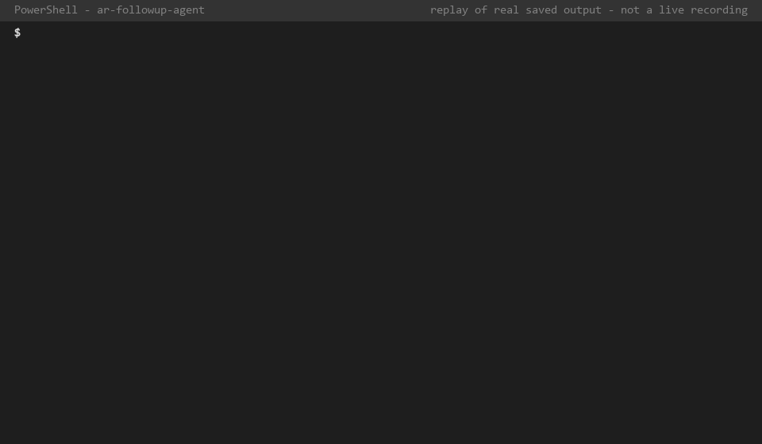
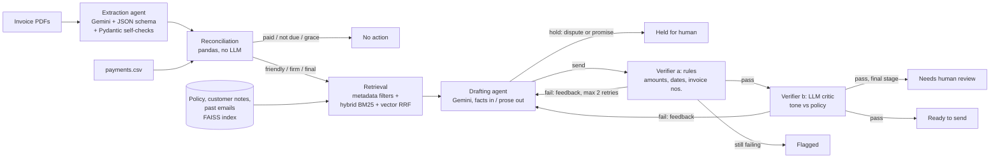

# AR Follow-up Agent

A multi-agent pipeline that reads invoice PDFs, reconciles them against a payment ledger, and drafts
policy-compliant payment-reminder emails, with a verifier that checks every amount, date and invoice
number in each draft against the source data before anything is sent.

**This is a learning/demo project on synthetic data.** It's not used by any company and isn't hardened
for real financial data. See [Limitations](#limitations).



*Terminal replay rendered from real saved output (`scripts/make_demo_gif.py`), not a live screen recording.*

## The problem
Accounts receivable (AR) teams chase unpaid invoices by hand: read the invoice, check what's been paid,
work out how late it is, look up how this customer should be approached, and write an email. The text
part is a natural fit for an LLM. The numbers are not: a reminder that asks for the wrong amount, or
ignores an open dispute, damages the customer relationship. So the design question is how to use an
LLM for language while making the facts verifiable.

## Architecture



All arrows are a plain-Python loop (`src/coordinator.py`). No agent framework: every step is a function
call, and every call is logged in a per-invoice trace.

| Component | File | What it does |
|---|---|---|
| LLM wrapper | `src/llm.py` | Gemini calls, disk cache, rate-limit spacing, backoff, token/latency accounting |
| Synthetic data | `src/generate_data.py` | 20 invoice PDFs in 3 layouts, payments, customers, ground truth (seeded) |
| Extraction | `src/extract.py` | PDF → JSON via Gemini structured output; Pydantic + arithmetic checks; retry with error feedback |
| Reconciliation | `src/reconcile.py` | Match payments to invoices; balance, status, days overdue, policy stage |
| Retrieval | `src/rag.py` | gemini-embedding-2 + FAISS; BM25; Reciprocal Rank Fusion; metadata filters |
| Drafting | `src/draft.py` | Writes the email (or holds it) from a code-rendered FACTS block + retrieved CONTEXT |
| Verifier | `src/verify.py` | (a) deterministic value checks, (b) LLM critic for tone/policy |
| Coordinator | `src/coordinator.py` | Plan-and-execute loop with retries and traces |
| API | `src/api.py` | FastAPI `POST /run` |
| Evaluation | `eval/` | `python -m eval` prints the results table |

## Example
Invoice INV-1008: USD 6,264.00, due 13 September 2026, USD 2,505.60 paid, 35 days overdue → "firm" stage.
Retrieval finds the customer's note ("pays in instalments; acknowledge partial payments"), their email
about the partial payment, and the firm-stage policy. The drafted email (real output, verified):

> Dear Marcus Ortega,
>
> I am writing regarding invoice INV-1008 for USD 6,264.00, which was due on 13 September 2026 and is
> now more than 30 days past due.
>
> Thank you for the payment of USD 2,505.60 received on 16 September 2026. This leaves an outstanding
> balance of USD 3,758.40.
>
> We kindly ask that you arrange payment of the remaining balance within 7 days, or provide a firm
> payment date. You can pay by bank transfer to Example Bank, account 000123456789, quoting INV-1008.
>
> Under our payment terms, a late-payment charge of 1.5% per month may apply to overdue balances. [...]

INV-1009 (same stage) is **held** instead: *"Invoice INV-1009 is currently disputed by the customer and is
under review by the account manager."*

## How to run (Windows / PowerShell)
```powershell
python -m venv .venv
.venv\Scripts\activate
pip install -r requirements.txt
Copy-Item .env.example .env        # then put your Gemini API key in .env

python -m src.generate_data                     # data/ (seed 42): PDFs, CSVs, ground truth
python -m src.coordinator                       # full pipeline -> outputs/run.json
python -m eval                                  # results table (uses the response cache)
python -m eval --no-cache                       # fresh, uncached timing run
python -m pytest -q                             # 51 tests, no API calls

uvicorn src.api:app --reload                    # http://127.0.0.1:8000/docs
```
Held-out extraction set: `python -m src.generate_data --out data_holdout --seed 7`, then
`python -m eval --data data_holdout`.

**Docker** (API only; requires Docker Desktop):
```powershell
docker build -t ar-followup-agent .
docker run --rm -p 8080:8080 --env-file .env ar-followup-agent    # http://localhost:8080/docs
```
The image contains only `src/` and `data/corpus/`; the API key is passed at run time and never copied
into the image. A fresh container has no response cache, so its first request also embeds the 46-chunk
corpus (about 4 minutes at the default 12 requests/minute). *Status: the Dockerfile has not been built
on the author's machine (no Docker installed). What was checked: all pinned packages resolve to Linux
x86-64 wheels for Python 3.12, the base image tag exists, and the API runs end to end from a folder
containing only the files the image copies.*

Model: `gemini-3.5-flash-lite` (free tier: 15 requests/min, 500/day); embeddings: `gemini-embedding-2`.
Every LLM and embedding response is cached in `.cache/`, keyed by a hash of model + prompt + input.

## Results
All numbers are from real runs on synthetic data (dev set: seed 42, 20 invoices, 9 needing a reminder).
Latency and tokens are from a live, uncached run on the free tier.

| Metric | Result |
|---|---|
| Extraction: invoices with every field correct, **held-out set** (seed 7) | **20/20** |
| Extraction: same, dev set (first prompt → after fixing one error) | 19/20 → 20/20 |
| Retrieval (hybrid): relevant past emails in the top 1 / top 2 | 8/18 / 15/18 (max possible 9 / 17) |
| Hold decisions correct (dispute / payment promise): deployed run / stress sample | 8/9 / 42/45 |
| Drafts containing a wrong value, without verifier (deployed / stress sample) | 0/6 / 0/32 |
| Drafts containing a wrong value, with verifier | 0/6 |
| **Seeded value errors caught by the rule verifier** | **33/33**, 0/6 false flags |
| Seeded tone violations caught by the LLM critic | 8/8, 0/6 false flags (3/32 in stress sample) |
| Model API time per invoice (all 20 / the 9 drafted) | 15.3 s / 24.7 s |
| Tokens per invoice (in / out) | 1,691 / 348 |
| Approx. cost per invoice at paid-tier prices | $0.0014 |

**Retrieval of past emails** (30 emails, 4–6 per customer; 18 relevant to the 9 actionable invoices, half
naming the invoice number, half describing it indirectly):

| Method | Top 1 | Top 2 | Top 2, direct | Top 2, indirect |
|---|---|---|---|---|
| Keyword (BM25) | 8/18 | 14/18 | 6/9 | 8/9 |
| Vector (gemini-embedding-2) | 7/18 | 13/18 | 7/9 | 6/9 |
| **Hybrid (Reciprocal Rank Fusion, k=60)** | **8/18** | **15/18** | 7/9 | 8/9 |

**How to read these numbers**
- **Extraction:** the first dev-set run got 19/20 (a customer ID glued to a name). I fixed the prompt and
  measured on a held-out set generated with a different seed: 20/20. Both sets use the same three layouts,
  and with n=20, an error rate of up to ~15% is still statistically plausible.
- **Verifier:** the drafter made no value errors at all (0 in 38 drafts, confirmed by an independent scan
  of every number), so the verifier's natural benefit can't be measured here. The evidence is the seeded
  test: digit swaps, ±100 offsets, shifted dates, another of the customer's invoice numbers, wrong currency,
  and the original total in place of the balance. Those corruption types were designed knowing what the
  checker looks for, so 33/33 is an optimistic upper bound.
- **The LLM critic is fallible:** in the stress sample it flagged 3 clean drafts (it misapplied a customer
  note), and neither checker notices when a draft ignores a customer's request.
- **Non-determinism:** two deployed runs disagreed on INV-1012 (sent once, held once because the customer
  asked for a GST invoice copy). By the policy this should be sent; a human might reasonably hold it.
- **Hybrid retrieval** wins by 1–2 emails, which is within noise at n=18. Keyword search's strong indirect
  score is partly a test-set artifact: the indirect emails reuse the line-item wording.
- **Stress sample** = 5 drafts per invoice at temperature 1.0 (deployed setting: 0.2), to provoke errors.

## Design decisions
**Why no LLM for reconciliation?** Matching payments to invoices, summing split payments and counting days
overdue is exact arithmetic and lookup. Pandas does it instantly, for free, identically every time, and
it's unit-tested against ground truth (19 tests). An LLM adds cost, latency and the chance of a "rounded"
balance, with no benefit.

**Why a deterministic verifier before an LLM critic?** For facts that have a ground truth (amounts, dates,
invoice numbers), a rule check is exact, free and testable (26 unit tests), and it can't be talked out of
a result. It can't judge tone, so an LLM critic does that, but only on drafts whose facts already passed.
The critic's own false flags (3/32 in the stress sample) show why it shouldn't be the only check.
Supporting design: code renders every number into a FACTS block and the drafter only copies them, so "any
number not in FACTS" is a precise definition of an error.

**Why RAG instead of putting the whole policy in the prompt?** The policy alone (~800 words) would fit
easily, and stuffing it would be a fine choice. RAG earns its place on the customer side: notes and email
history grow without bound, and which past email matters depends on the invoice. Retrieval is also
selective by design: rules that depend on known facts (stage, partial payment) are selected by metadata,
and only free-text signals (which email is about this invoice, is there a dispute) use search. Logging what
was retrieved makes each email traceable.

**Why hybrid search?** Embeddings blur exact identifiers (all of a customer's emails scored within 0.03
cosine of each other), and keyword search misses paraphrases. Reciprocal Rank Fusion merges the two
rankings using ranks only, so the scores never need calibrating, and its constant (k=60) wasn't tuned.

**Why a plain-Python coordinator?** The order of steps is fixed, so a framework would add indirection
without adding capability. Every line is explainable, failures show up in the trace, and no LLM calls are
spent deciding what to do next.

## Limitations
- **Synthetic data only.** Clean, machine-generated PDFs in three layouts; hand-written emails and policy.
  Real invoices (scans, multi-page tables, credit notes, many currencies) would be much harder.
- **Small evaluation sets:** 20 invoices, 9 reminders, 18 labelled emails. Treat the numbers as evidence
  that the mechanisms work, not as accuracy estimates.
- **Tuned on what it's tested on:** the drafting prompt was clarified once after a dev-set bug (it held
  final notices "for human review"), and the hold metric uses the same invoices.
- **Verifier blind spots:** a wrong-role number is only caught if the right one is then missing; ignored
  customer requests and subtle tone issues get through.
- **Not deterministic:** the same invoice can get a different decision on a re-run.
- **Free-tier API:** latency includes queueing, and Google may use free-tier inputs to improve its
  products, which is acceptable only because all data here is synthetic.
- **Not a product:** no authentication on the API, no email sending, no persistence, and the API runs
  synchronously (minutes for a large uncached batch). The Docker image is untested (see How to run),
  and nothing is deployed.
